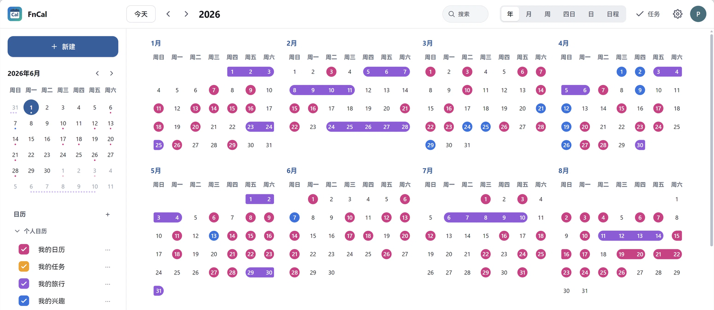
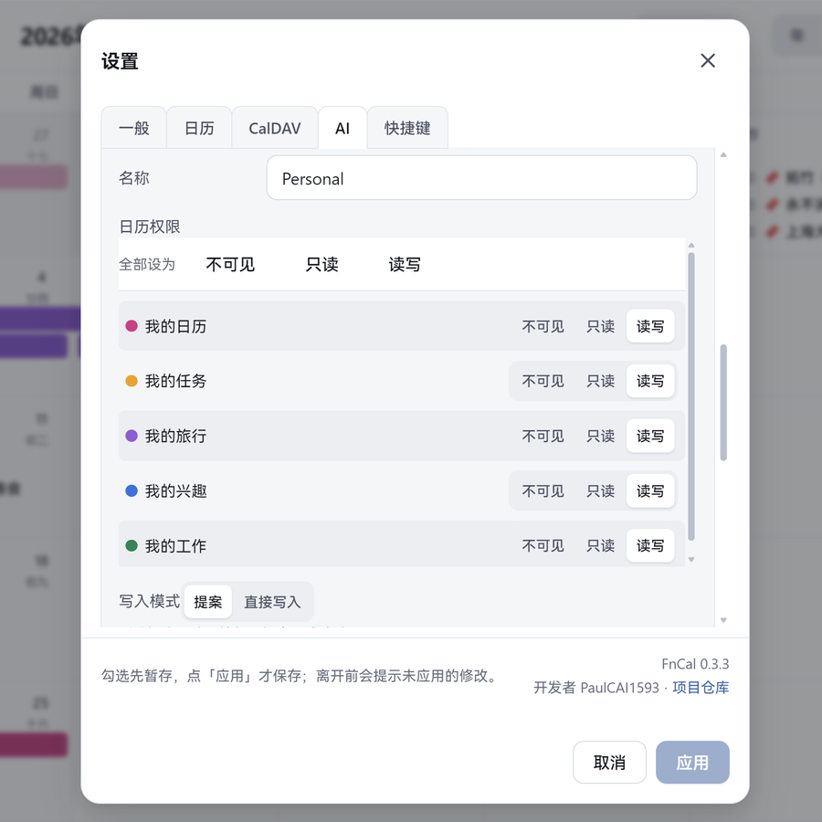
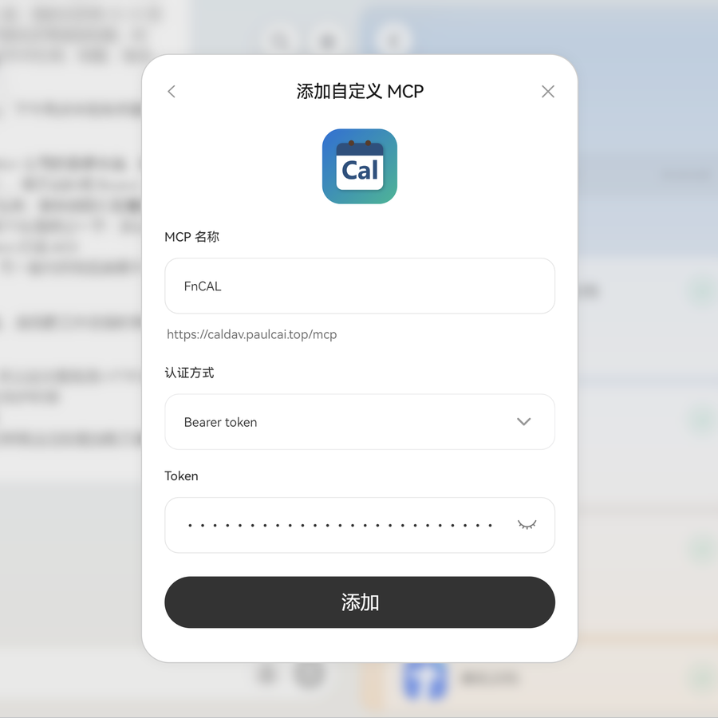

# FnCal

**本地优先的日历，跑在飞牛OS（fnOS）上。自带 CalDAV 服务，也能让 AI 助手安全地读写你的日程；数据只存放在你自己的 NAS。**



当前版本：**0.7.24**

[](LICENSE)
[](https://github.com/PaulCAI1593/FnCal/releases)
[](https://www.fnnas.com/)

**项目页面**：<https://paulcai1593.github.io/FnCal/>

**下载**：网页安装包、安卓 APK 与校验文件在 GitHub 发布页 <https://github.com/PaulCAI1593/FnCal/releases>。AI 技能包单独发版，见 [技能包发布页](https://github.com/PaulCAI1593/FnCal/releases/tag/skill-v0.7.13)。

*国内访问慢时可用 [Gitee 镜像](https://gitee.com/Paul1593/FnCal/releases)，内容与 GitHub 相同。*

---

## 两条 AI 能力

接上 MCP 之后，AI 能做的就两件事：读日程、改日程。

- **读懂日程、提炼习惯、推荐行程**：读你授权范围内的日历，找出空档与规律（例如工作日上午开会、周三晚跑步），给出可采纳的建议。只读凭据连写工具都看不到。
- **改日程走审批**：AI 提出改期，写明与哪条日程冲突；你在提案里点「批准」才写入，拒绝就丢弃。删除类提案会红字写明「批准后无法恢复」，回收站保留期内可从「最近删除」还原。

这两条都在下面的四步里落定：边界怎么划、改动怎么批、谁点最后一下。

---

## AI 助手：提案与审批，决定权在你

AI 客户端（Claude、ChatGPT、Cursor 等支持自定义 MCP 的客户端）可以接入 FnCal。默认情况下它**只能看、不能改**；能改的写入也默认走提案，要你点头才落库。

**第一步：定边界。** 一个 AI 客户端一个凭据，单独签发、单独吊销、单独限流。每个日历可设「不可见 / 只读 / 读写」，默认全部不可见——对 AI 来说，不可见的日历等于不存在。可读时间窗默认过去 7 天 / 未来 90 天；地点、描述、参与者可按字段开关。

**第二步：AI 只提案。** 新建与修改默认「提案」，删除默认「提案」（也可选回收站，删除立即生效但可还原）。提案模式下 AI 返回 `applied: false`，你的日历没有变化。

**第三步：链接交给你。** 不能弹确认框的客户端，会拿到一条一次性审批链接（`…/a/<token>`，10 分钟有效，每条只能决定一次）。页面就是提案队列，可设 4 位 PIN：**PIN 不要告诉 AI 助手**。

**第四步：你点才算数。** 支持弹窗的客户端，批准只认 FnCal 自己弹的确认框；没有弹窗的一律返回 `approval_requires_ui`，一条都不执行。AI 转述的「用户已同意」不算数。0.5.8 起你点完批准或拒绝，服务端会向该凭据推送一条结果通知，AI 不必再回读。

**待确认提案看顶栏铃铛。** AI 接入关闭时铃铛隐藏；开启后一直显示——没有待确认是描边图标，有待确认变主题色实心，悬停与读屏标签报条数。设置里不再有红点。

*AI 接入设置：日历授权三档与写入模式*



*在 AI 客户端里添加自定义 MCP：名称、连接地址、Bearer 令牌*



---

---

## 六条特色

### 1. 数据在自己的 NAS 上

账号、日历、事件、任务全部落在 NAS 本机（默认 `/vol1/@appdata/FnCal/`）。运行期不请求任何第三方服务：没有遥测、没有统计脚本、构建产物不含 CDN 依赖。一个 fnOS 应用包装好，安装向导填端口与管理员账号即可用；也提供 Docker 部署。备份就是备份那个目录，换机器把目录带过去再装即可。

### 2. 标准 CalDAV，不是封闭格式

内置 CalDAV 服务器，按 RFC 4791 实现，事件（VEVENT）与任务（VTODO）都支持。每个日历在客户端里是一个独立集合，各自颜色与只读标记会被识别。手机、电脑上的标准日历客户端可以直接读写同一批数据。

### 3. 六种看法，一套数据

年 / 月 / 周 / 四日 / 日 / 日程六个视图看同一份日程。左侧迷你月历点年月可快速跳转；年视图用色块呈现一整年的安排；日程视图在标题下显示地点，长地点单行省略。手机上六个视图保留桌面元素，只按宽度缩放排布。

### 4. 每个日历一种颜色

可建多个日历，各自有名称、颜色、描述与显示开关，也能只显示某一个。事件颜色默认继承所属日历，单条事件可另行覆盖。日历可删（非空会提示将删除多少条，并给 10 秒撤销）；「我的日历」「任务」两个内置日历不可删、可改名。

### 5. 事件和任务分开管，中国节日与节气

待办用独立的「任务」日历，与事件分开；它同样通过 CalDAV 以 VTODO 暴露给客户端。中国法定节日与二十四节气都可开关：同一天只显示一个，节日优先，不标调休、不联网，节气按北京时间离线推算。`.ics` 可导入为新日历或并入现有日历，也可按日历导出，保留时区、重复规则与提醒。

### 6. 多标签系统

给日程和任务挂一个 emoji 标签：标签在设置里分组管理，可新建、改名、拖动排序，分组可折叠；一个日程或任务只挂一个标签。月视图、周 / 四日 / 日、日程列表与搜索结果都显示「emoji + 名称」，窄到放不下名称时只留 emoji。筛选面板可按标签多选、也能只看「无标签」，与日历、颜色、时间条件叠加。导出时标签写进 `CATEGORIES`，标准客户端也能看到。AI 凭据在授权后也能新建、改名、删除标签。

**安卓端**：外壳直连你自己的 NAS，填地址就能用，不经过任何中转。桌面可加五款只读卡片：迷你月历、单日日程、月视图、四日视图、日程列表，跟随登录态自动刷新，约 30 分钟更新一次；状态栏与手势条透明，内容留在安全区内。

**安卓下载**：`FnCal-Android-0.3.8.apk` <https://github.com/PaulCAI1593/FnCal/releases/download/android-v0.3.8/FnCal-Android-0.3.8.apk>，988,397 B，SHA-256 `c08f88df7477557ff3c6064f63a7288893f57968494033c665adbd2d082c698c`；release 构建 + R8 压缩，包体约为上一版四分之一，可直接覆盖 0.3.7，不用卸载。

*国内访问慢时可用 [Gitee 镜像](https://gitee.com/Paul1593/FnCal/releases/download/android-v0.3.8/FnCal-Android-0.3.8.apk) 下载同一个包。*

**还有这些**

- 搜索可按关键词与时间范围筛选，手机端筛选项分组排布、可滚动。
- 标签：分组管理、拖动排序，日程与任务各挂一个；月视图、周 / 四日 / 日、日程列表与搜索都显示「emoji + 名称」，可按标签筛选，导出写进 `CATEGORIES`。
- 设置项：时区、每周开始日、是否显示周数、事件默认提醒与默认全天提醒、公共假日与节气开关、主题色。
- 头像菜单里有「检查更新」：先查 Gitee 镜像，再查 GitHub；发现新版本可直达下载，安装包优先从 Gitee 取。
- 「新建」只分事件与任务两类；任务按钮在搜索与设置之间，点开右侧栏看全部任务。
- 节日与节气各有颜色与图标：年视图不显示节日与节气；月视图、周 / 四日 / 日、日程列表与详情卡带图标，节日用旗子配主题色，节气用太阳配主题色的互补色，图标与文字同色；日程视图日期列也带图标，「周X · M月」保持单行。
- 迷你月历只留日号与事件点，不再显示农历、节日、节气那行小字。
- 多端一致：网页、安卓外壳、标准 CalDAV 客户端读写同一批数据。

---

---

## 安装

**系统要求**：飞牛OS（fnOS）≥ 1.2.0401，x86 / arm，依赖 `nodejs_v22`。

1. 下载 `FnCal-0.7.24.fpk`：<https://github.com/PaulCAI1593/FnCal/releases>（国内慢可用 [Gitee 镜像](https://gitee.com/Paul1593/FnCal/releases)）；
2. 先核对哈希（见下），再在 fnOS 应用中心安装；
3. 安装向导里填一个未被占用的空闲端口（建议 1024 以上，避开系统保留端口；不要填 5232，那是 Radicale 的默认端口），并设定管理员用户名与密码；
4. 装完后点桌面图标，会在浏览器新标签打开 `http://<NAS-IP>:<端口>/`，用刚设的账号登录。

**核对哈希**

```bash
sha256sum FnCal-0.7.24.fpk
# Windows: Get-FileHash .\FnCal-0.7.24.fpk -Algorithm SHA256
```

期望值也写在 `SHA256SUMS.txt` 里。0.7.24 安装包（802,026 B）的 SHA-256：

```
14375E0AF1B2C36D7249BCB011BDAB3D9D89D89D448C78BBB2ACEEBEF0548387
```

**升级**

在应用中心覆盖安装即可，数据保留。账号数据里若已存在 TOTP 种子，升级后会自动转成密文（AES-256-GCM）。

**回滚注意**：0.2.36 及更早版本读不懂加密后的 TOTP 字段；从 0.2.37+ 回滚前需先重置相关账号的两步验证；0.4.0 起这一步可以在「安全设置 → 我的安全」里做。

---

## 数据与备份

数据全部落在 NAS 本机的应用数据目录（默认 `/vol1/@appdata/FnCal/`，随安装的存储卷不同而变化）：

- `accounts.json`：账号与安全设置；
- `secret.key`：本机会话与加密密钥，别删（删了所有会话失效，加密字段也无法解密）；
- `ai-settings.json`：AI 接入的实例级设置；
- `calendars/`：各账号的日历与事件文件；AI 凭据、提案与回收站放在各账号目录的 `.data/` 下（`ai-credentials.json`、`ai-proposals.json`、`ai-trash.json`），令牌只存哈希，明文不落盘；
- `logs/`：审计日志与访问日志。

备份用 fnOS 应用中心的备份功能，或直接备份该目录。

---

## CalDAV 客户端配置

| 项 | 值 |
|---|---|
| 服务器地址 | `http://<NAS-IP>:<端口>/`（套了 HTTPS 反代就用反代地址） |
| 用户名 | 登录 FnCal 的用户名 |
| 密码 | 登录密码；也可在「安全设置 → 我的安全」创建 CalDAV 专用密码（可单独吊销，推荐） |

配置后，各日历会作为独立集合出现在客户端里。客户端写入的 `VALARM`（提醒）会原样保存，但 FnCal 自身不触发提醒——提醒由客户端负责。DAVx5、Thunderbird、eM Client 等按 RFC 4791 实现的客户端可用；实际兼容性以你的客户端实测为准，iOS / macOS 系统日历未做真机验收。

---

## AI 助手配置（MCP）

**这套能力默认是关的，只有管理员能打开。**

1. 打开 设置 → **AI** 页签 → 打开「服务」开关（改完点底部的「应用」）；
2. 「凭据」里点「新建凭据」：填名称、勾选每个日历的权限（默认全「不可见」）、按需设时间窗与字段开关，再按两组选「操作方式」——新建、修改（提案 / 直接通过，默认提案）与删除（提案 / 回收站，默认提案）；标签另有「新建与编辑」「删除」两组，同样选提案或直接通过，默认提案；
3. 保存后**令牌只显示一次**，立刻复制走（丢了只能删除后重建）；
4. 把「MCP 连接地址」或旁边的「MCP 配置片段」交给 AI 客户端，按客户端要求填：
   - 客户端有单独的 **Bearer Token / 访问令牌** 输入框：只填令牌本体（`fncal_ai_` 开头那串），**不要带 `Bearer` 前缀**，地址填到 URL 字段；
   - 客户端只让你写原始 HTTP 头：写成 `Authorization: Bearer <令牌>`（`Bearer` 与空格都要有）。

| 项 | 值 |
|---|---|
| 连接地址 | `http(s)://<你的地址>/mcp`（直连用 http，套 HTTPS 反代用 https；地址在 AI 页的「服务」块里，可复制） |
| 认证 | `Authorization: Bearer fncal_ai_…` |
| 协议 | MCP Streamable HTTP。普通请求回 JSON；需要弹窗确认时走 SSE 下行流，`initialize` 后返回 `Mcp-Session-Id`（会话 30 分钟过期、上限 500）。不带会话头的客户端照常可用；批准时返回审批链接（`approval_requires_ui` + `approvalUrl`，10 分钟、每条一次） |
| 工具 | 读：`list_calendars` / `list_events` / `get_event` / `find_free_slots`；写：`create_event` / `update_event` / `delete_event`（**只读凭据连写工具都看不到**）；标签：`create_tag` / `update_tag` / `delete_tag`（受「新建与编辑」「删除」两组控制）；提案：`list_proposals` / `decide_proposals` / `approve_proposal` / `reject_proposal`（后四个只在凭据开启「对话内代办批准」后可用） |

附一份 **MCP 技能包**，独立发版，当前 0.7.13：`FnCal-MCP-Skill-0.7.13.zip`（29,576 B / `C99F957BE9FBFE73C328F3908FC7144A95FA7958DE38FA06D473A266CBA7A633`），从 [技能包 Release](https://github.com/PaulCAI1593/FnCal/releases/tag/skill-v0.7.13) 下载，交给 AI 客户端当使用说明。技能包与 FnCal 分开升级：源文件在仓库 `skills/fncal-mcp/`，你说「升级技能包」时 AI 会从 Gitee 镜像与 GitHub 两个地址依次拉最新版并比对版本号，拉不到就用本地版本、不阻塞对话。细节与排错见技能包里的 `reference/setup.md`。

---

## 与 AI 协作的细节

**凭据与授权**

- 一个 AI 客户端一个凭据：单独签发、单独吊销、单独限流；令牌形如 `fncal_ai_…`，只显示一次。
- 每个日历三档：不可见 / 只读 / 读写。默认新建的凭据对所有日历都是「不可见」。
- 「不可见」等于不存在：日历列表里没有它，搜索、空闲检测、冲突检测、单条查询与按 id 访问一律按不存在处理（返回 404，不泄露它存在）。
- 读受时间窗限制：默认过去 7 天 / 未来 90 天，两侧可单独设「不限制」；窗外的事件同样表现为不存在。
- 字段级开关：标题与时间必给；地点、描述、参与者可选（默认只给地点）。

**写操作与回收站**

- 新建、修改：两档，按凭据选——「提案」或「直接通过」，默认提案。提案 24 小时有效，接受时做版本冲突检测。
- 删除：两档，按凭据选——「提案」或「回收站」。回收站档下 AI 删除立即生效，日程进入回收站，保留期内可在提案面板「最近删除」还原；保留期默认 7 天，可选 3 / 7 / 14 / 30 天。两种档位切换都要二次确认。

**对话内代办批准（可选，默认关）**

- 打开后 AI 可以在对话里处理提案，但批准只认 FnCal 自己弹的确认框；没有弹窗能力的客户端一律返回 `approval_requires_ui`、一条都不执行，也不接受 AI 转述的「用户已同意」。
- 这类客户端会拿到审批链接：`…/a/<token>`，10 分钟内有效、每条提案只能处理一次。页面就是提案列表的样子——顶部「刷新」、剩余 2 条以上有「全部批准 / 全部拒绝」，每条卡片自带「批准 / 拒绝」，不暴露 API。
- PIN 只在凭据开启「对话内代办批准」且新建修改或删除至少一项为提案时可设 4 位数字：页面先输 PIN，没设 PIN 打开链接即可批（**PIN 不要告诉 AI 助手**）。
- 有弹窗时：1 条待确认不问模式，直接弹单条确认；2 条以上由 FnCal 弹「全部批准 / 逐条审批」，以你点的为准；AI 不得替你做选择。「全部批准」一次最多 100 条，逐条执行，部分失败不中断，最后给成功 / 失败汇总。
- 0.5.8 起你点完「批准」或「拒绝」，服务端向该凭据已打开的 MCP 连接推送通知（`notifications/fncal/approval-decision`）；AI 也可以调用 `wait_for_approval` 短暂等你点完；下次读取回包里带一次 `receipts`（同一条只给一次，保留 24 小时，不含令牌、PIN、链接）。

**审计与限流**

- 按凭据限流（默认 60 次/分钟，可按凭据调整）；审计只记工具名与时间，不记令牌与事件正文。

---

## 安全

- 本地账号密码登录，密码用 bcrypt（cost 12）哈希，升级时自动重哈希；
- 登录失败限流与账号锁定、CSRF 双提交校验、会话失效、安全审计日志；
- 安全响应头（nosniff / Referrer-Policy / Permissions-Policy）；
- 默认按 TCP 对端地址判定来源，不采信客户端自称的转发头。

> 两步验证（TOTP）、CalDAV 专用密码、反向代理与真实来源、登录活动概览、证书与审计这些高级安全能力，
> 现在都有界面入口：点右上角头像 → **我的安全**（所有用户）；管理员另有 **安全设置**，分四个页签：
> 我的安全 / 登录访问 / 加密证书 / 审计。
>
> 加密证书页有一项「通过反向代理提供 HTTPS」。它只在**当前请求确实经可信反向代理以 HTTPS 到达**时才允许开启，
> 避免把你自己关在门外；开启后浏览器用 HTTP 访问会被 301 到 443，证书由反向代理负责。

> FnCal 不做来源 IP 白名单。谁能访问到这个端口，谁就能看到登录页；暴露面取决于你的网络、端口映射与防火墙。**对公网开放时请务必套 HTTPS 反向代理。**

---

## 从源码构建

源码结构与构建步骤见 [`BUILD.md`](./BUILD.md)。需要 Node.js 22。前端 Vite 构建，后端是零第三方运行期依赖的 Node 服务（仅内置模块 + 应用内 vendored 的 `ical` / `bcryptjs`）。测试用 Vitest；发布前跑前端全量与五项静态审计（i18n / 生命周期 / 零云 / 图标 / 文案长度）。

---

## 用 Docker 部署

仓库根目录提供 `Dockerfile`、`docker-compose.yml`、`entrypoint.sh`、`.dockerignore`，完整说明见 [`DOCKER.md`](./DOCKER.md)：

```bash
docker compose up -d --build      # 然后在 http://<NAS-IP>:5581/ 登录
```

数据放在 `/data` 卷（`accounts.json`、`secret.key`、`calendars/`、`logs/`）。首启可用 `CALDAV_ADMIN_PASSWORD` 直接设定管理员密码；留空则生成随机密码并写入容器内 `/data/admin-initial-password.txt`（0600，首次登录后请立即修改）。容器以 root 进入，入口脚本按 `PUID`/`PGID` 修正 `/data` 属主后降权运行。HTTPS 端口默认 `5243`。

---

## 版本记录

每个版本的改动见 [`CHANGELOG.md`](./CHANGELOG.md)。0.6.x 主要变化：设置页签收拢与诊断包迁移、登录设备与接入管理、权限独立提示、桌面卡片接口与安卓桌面卡片、卡片多行排版、二十四节气、手机日号行与跨天条几何修正、节日与节气在月视图、周 / 四日 / 日与日程列表的配色与图标统一、迷你月历精简、日程视图日期列不折行。0.7.x 加入标签系统（分组、拖动排序、按标签筛选、导出写进 `CATEGORIES`），并连续修正月格与周视图排版：名称按本格实际宽度显示、单日全天补 emoji、折叠按每格实测高度、跨天定时事件裁进当天时间轴。0.5.x 是手机端形态与 AI 审批链路的成型阶段。

---

## 致谢

**特别感谢 [HeyPuter/everything](https://github.com/HeyPuter/everything/tree/main/src/calendar) 项目。**

FnCal 的前端界面与日历逻辑起点就是它的 `src/calendar`：六个视图的信息架构、日历网格与日程渲染、
事件与重复规则的交互骨架，都来自这个项目。感谢 HeyPuter / Puter Technologies 团队把这套代码以
MIT 许可证开放出来——没有它，这个项目不会存在。FnCal 在此基础上删掉了全部云耦合、重写了认证与
数据层、加了中文与多日历 / 任务 / 中国节日，最终把它做成一个「装在自己 NAS 上、数据完全属于自己」
的形态。

同时感谢这些开源项目：

- **[bcryptjs](https://github.com/dcodeIO/bcrypt.js)** — 纯 JS 的 bcrypt 实现，让应用不必编译原生模块；
- **[Vite](https://vite.dev/)** / **[Vitest](https://vitest.dev/)** / **[jsdom](https://github.com/jsdom/jsdom)** — 前端构建与测试；
- **[Node.js](https://nodejs.org/)** — 后端运行时。

完整第三方代码清单、版本与来源见 [`THIRD_PARTY_NOTICES.md`](./THIRD_PARTY_NOTICES.md)。

本项目在 [DeepSeek Harness](https://github.com/deepseek-ai/deepseek-harness) 的多 Bot 团队协作下开发与发布：

[](https://github.com/deepseek-ai/deepseek-harness)

---

## 许可

MIT License，Copyright (c) 2026 **PaulCAI1593** <https://github.com/PaulCAI1593/>。

前端源自 [HeyPuter/everything](https://github.com/HeyPuter/everything) 的 `src/calendar`（MIT，版权归 Puter Technologies Inc.），已剥离全部云依赖并重写认证与数据层。完整第三方声明见 [`THIRD_PARTY_NOTICES.md`](./THIRD_PARTY_NOTICES.md)。

---

## 链接

- 仓库（GitHub）：<https://github.com/PaulCAI1593/FnCal>
- 仓库（Gitee 镜像，国内更快）：<https://gitee.com/Paul1593/FnCal>
- 问题反馈：<https://github.com/PaulCAI1593/FnCal/issues>
